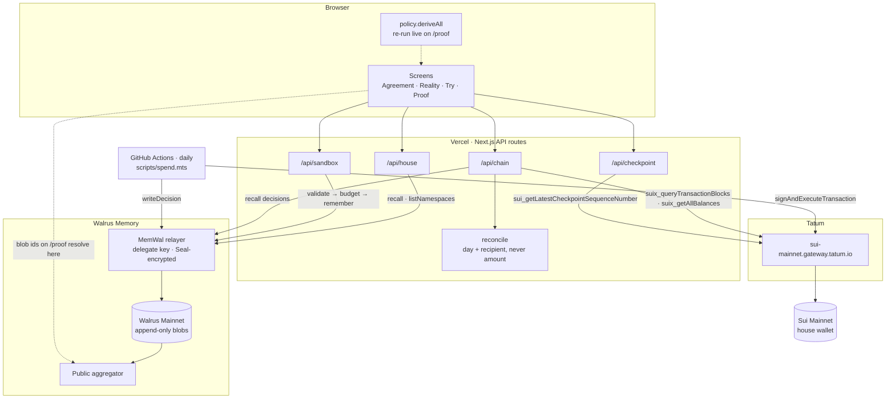
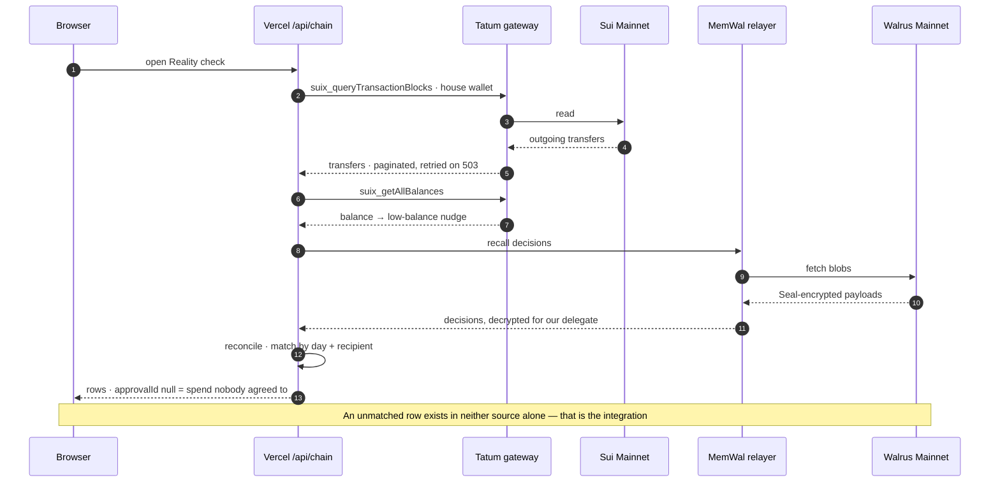
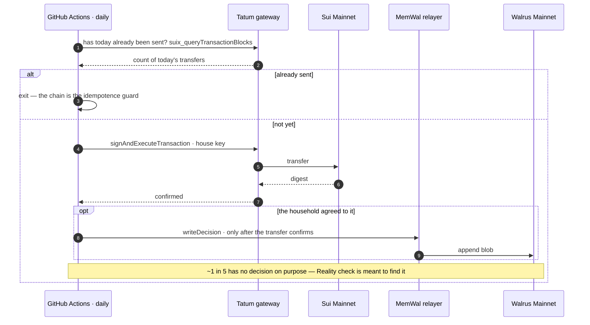

# Unwritten

*The spending agreement your house already has.*

**[unwritten-house.vercel.app](https://unwritten-house.vercel.app)** · Track 03, Consumer Finance

Every household answers one question informally and never writes it down: **who can spend what,
alone, up to how much.** Unwritten watches real decisions, derives the agreement, and tells you
when the rule you think you have is not the rule you actually follow.

Built for **Total Recall** (Tatum × Walrus Foundation, 20 Oct – 10 Nov 2026) · Track 03, Consumer
Finance.

## Try it

**[unwritten-house.vercel.app](https://unwritten-house.vercel.app)** opens on three doors:

- **The Wilson house** — a guided five-stop tour of a seeded six-week household, starting from a
  flowchart of how the house works: who asks, what gets classified, the gate, the decision, Walrus,
  the derived rules, the Tatum check, the ratification.
- **Try it yourself** — name your people, pick what your house spends on, set one number, and the
  same engine derives a rule from your decisions, written to Walrus Mainnet.
- **I'm a judge** — seven stops, each switching you to the role that screen needs, plus the
  architecture diagrams below.

Inside, the week control at the bottom replays the six weeks, and the role switcher shows what an
owner, an approver and a spender each get.

## Verify it

The fastest way: **[/proof](https://unwritten-house.vercel.app/proof)** has a *Run it live* panel
that calls Tatum (checkpoint, house wallet) and Walrus Memory (the house's namespaces) from your
browser and shows the answer and its latency. Every blob id there links to its bytes on a public
aggregator and to its onchain record on [Walruscan](https://walruscan.com) — size, storage epochs,
and the `seal_encrypt_fence` / `certify_blob` transactions. Transfers link to Suiscan.


```bash
pnpm verify
```

Queries the live relayer and chain and prints: memory count per namespace, every blob id, the
two-account Observer comparison, and the onchain policy state. The `/proof` page carries the same
data with explorer links. **The app does not link to `/proof`** — the product is abstracted, the
evidence is findable.

### Seed disclosure

The Wilson house is seeded. A deterministic script runs **the real engine** over six weeks of
household decisions and writes them to Walrus Mainnet. Nothing is faked downstream of that script,
and every rule in the demo was derived by the same pure functions that run in production. We say
this out loud because an undisclosed seed is the kind of thing a reader is right to distrust.

### The screens read Mainnet

The Wilson house is not rendered from a local file. Every rule you see was recalled from Walrus
Mainnet and derived there by `packages/policy` — the belief ids on screen (`vb-m1-groceries-v1`,
`drift-household-v1`) are the ones the seeder wrote, and `pnpm verify` counts the same memories.

The sidebar says which it is. If the relayer is unreachable the app falls back to local fixtures
**and tells you so**, because a screen that quietly shows local data while claiming to read
Mainnet is exactly the kind of lie this project exists to avoid.

## How it works

| Layer | What it does |
|---|---|
| **Walrus Memory** (Sui Mainnet) | every decision and every derived rule, append-only and versioned |
| **Tatum** Sui RPC (gateway) | reads the household wallet; catches spend with no approval. Not the Data API — it does not cover Sui |
| `packages/policy` | the learning — seven dimensions, **pure functions, no LLM** |

## Architecture

The same diagrams render on [/judge](https://unwritten-house.vercel.app/judge), from
`apps/web/src/lib/diagrams.ts` — this section is copied from that file, not redrawn. Every edge is
a call the code makes. The owner key never reaches the server; only the delegate does.



**Reality check** — one request, both networks. An unmatched row exists in neither source alone.



**The daily history** — why the chain holds real days rather than one afternoon of transfers.



### One network

Everything runs on **Mainnet**, which turned out not to be a choice. A spike before the build
window found that `sui-testnet` and `sui-devnet` both return 404 on our Tatum key — only
`sui-mainnet` is reachable — and that the Walrus Memory credentials are mainnet-only, since
staging rejects an account that does not exist on that network.

So the two-network design we had planned was not available, and the result is simpler than what
we set out to build. Development writes are kept away from the seeded house by **namespace**
rather than by network.

### Three protocol facts that shaped everything

1. **There is no delete and no edit.** So a rule is never mutated — a new version supersedes the
   old one and names it. The constraint became the feature: you get an honest timeline of how the
   agreement changed. And data minimisation is structural, not hygiene — we never write item
   names, member names, or anything a deletion request would have to reach. Identity lives in
   Postgres, which *is* deletable; memory stores a stable ref and the role held at the time.
2. **A namespace is not a privacy boundary.** Delegate authorization is account-wide. We use
   namespaces for organisation only, and the house's stated value is total transparency anyway.
   Differential visibility is solved by scoping the **write**: an aggregate-only digest written
   into a second, Observer-owned account.
3. **Ratification touches two systems.** Chain first, memory second, always. A memory write before
   the transaction confirms could leave an immortal rule marked `ratified` with nothing behind it.
   The reverse order is recoverable: retry the write, keyed by belief id.

## What is honest about it

- **It is useless for roughly two weeks**, by construction. Evidence has to accumulate before a
  rule can form. Empty states say how many events are still needed rather than showing nothing.
- **The owner is a single point of failure** for every policy change. An approver can accept a
  proposal; only the owner key can sign it onchain. One owner per MemWalAccount — inherent, so we
  modelled it instead of hiding it, and the UI says so.
- **A permissive first number kills the learning.** Set it to $500 and everything auto-approves,
  so there are no decisions and therefore no evidence. We cap the input; the deeper fix needs a
  regret signal we do not have.
- **Regime change is unhandled.** A new baby or a job loss invalidates every rule at once, and the
  model would drift slowly when the truth is that everything changed on a Tuesday.
- **Rent, utilities, insurance and debt are out of scope.** Subscriptions have the same shape as
  rent, which is why the `rhythm` dimension exists at all.
- **Keys is a rehearsal.** Revoking this deployment's real delegate key would lock every visitor
  out of the house's memory — which is the property the screen demonstrates. So `/keys` plays the
  protocol's behaviour locally (the rotation counter moves, the next `remember()` fails) and says so
  on the screen.
- **Onchain ratification is not built.** Signing a proposal on `/digest` resolves locally and
  writes the new rule version to Mainnet; the Move package that would hold the ratified agreement
  does not exist, and the `ratifiedTx` on a seeded belief is a placeholder rather than a real
  digest. Every Walrus write and every Tatum read is real — this one thing is not, and a page that
  discloses its seed should disclose this too.

## Repo

```
docs/specs/      one spec per feature, Given/When/Then — code is built from these
packages/policy  the seven learning dimensions, pure functions, fully testable offline
packages/memory  the only caller of the Walrus Memory SDK
packages/chain   the only caller of Tatum
prototype/       the clickable field-discovery instrument the schema was derived from
PLAN.md          anti-drift: artifacts, build order, and 25 invariants
```

Two wrapper packages exist so that one file answers "where is every Walrus write" and one answers
"where is every Tatum read".

### Built with Tatum AI Builder

The first version of the main screen was generated on **[ai.tatum.io](https://ai.tatum.io)** and is
kept in its own repository — **[EdCryptoFi/unwritten-ai-builder](https://github.com/EdCryptoFi/unwritten-ai-builder)** —
rather than squashed into the first commit here, so the lineage is verifiable instead of asserted.

Two things from it survived into this codebase: the design tokens in `apps/web/src/app/globals.css`
are Tatum's own, extracted from that output, and `packages/chain` is built on its
`server/tatum-client.mjs`. What did not survive was the single-file shape — the generated screen
held state, fetching and rendering in one place, and the seven learning dimensions had to become
pure functions before they could be tested without a browser.

MIT.
